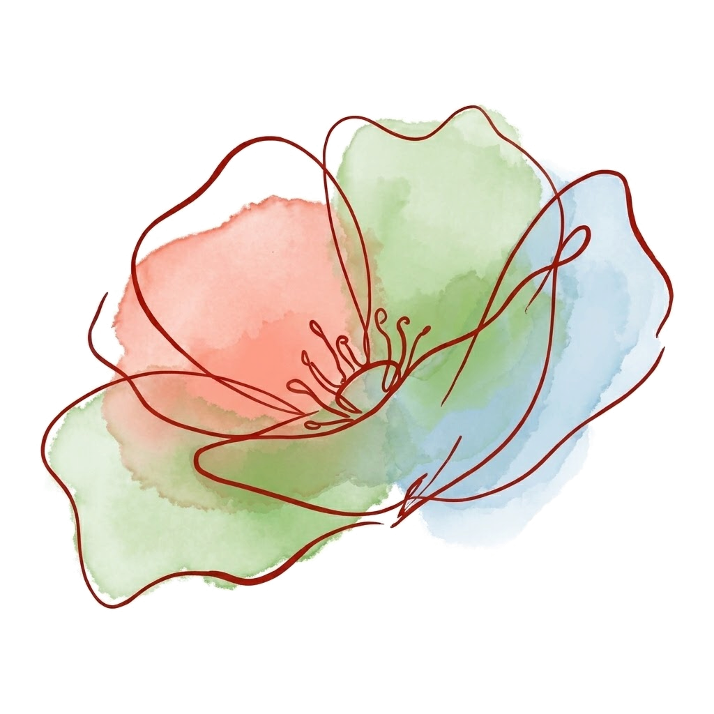
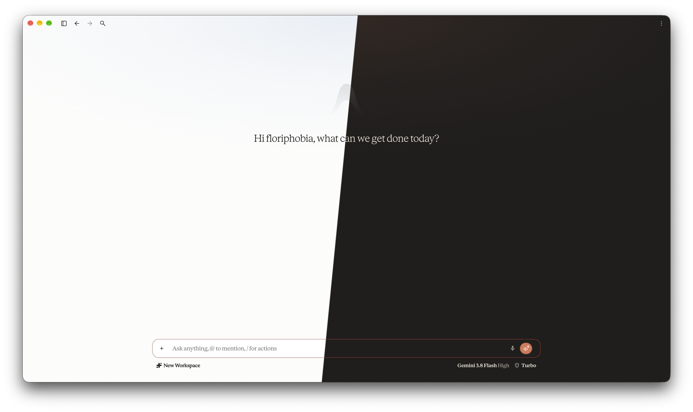
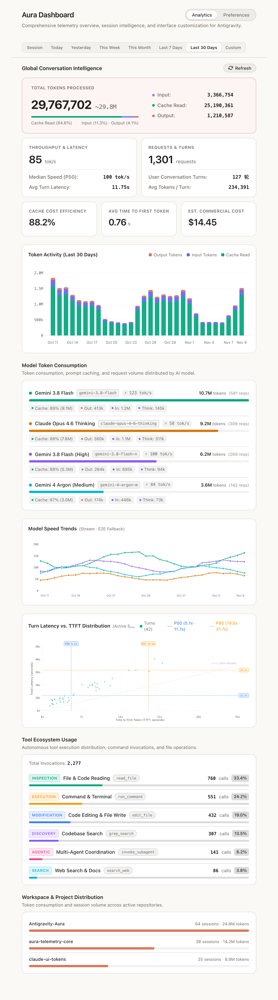
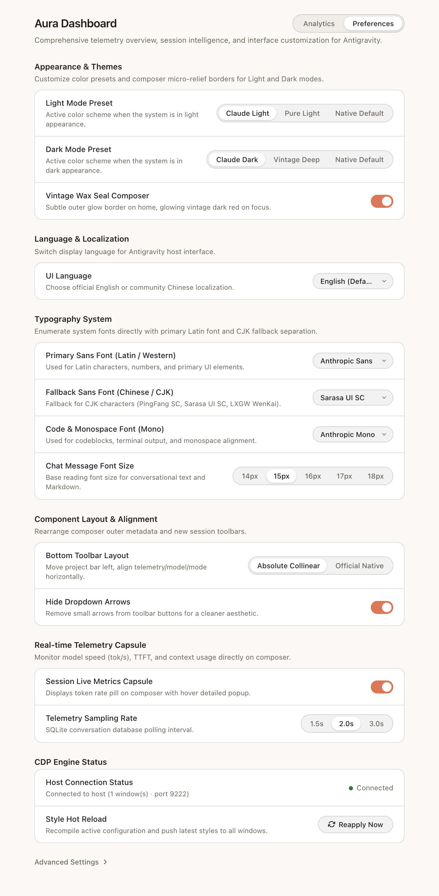

<div align="center">



# Antigravity Aura

**Theme presets, custom font stacks, and local SQLite performance analytics for Google Antigravity, built on the native Plugin + Sidecar API.**

[](https://github.com/sayakaho/Antigravity-Aura/releases)
[](https://github.com/sayakaho/Antigravity-Aura/actions/workflows/release.yml)
[-339933.svg)](https://nodejs.org/)
[](https://github.com/sayakaho/Antigravity-Aura)
[](LICENSE)

English | [简体中文](README.zh-CN.md)

[Features](#features) · [Screenshots](#screenshots) · [Installation](#installation) · [Configuration](#configuration) · [Architecture](#architecture) · [Credits](#credits)

</div>

## Overview

**Antigravity Aura** runs inside Google Antigravity's native Plugin + Sidecar lifecycle without patching `.asar` archives or running external OS daemons. The sidecar starts with the host application, attaches to active windows over CDP for live style and script injection, and reads the local SQLite conversation store via Node 22's built-in `node:sqlite` to serve an analytics and preferences panel in the Auxiliary Pane.

## Screenshots

### Workspace



### Auxiliary Pane

<table>
  <tr>
    <th width="50%">Analytics</th>
    <th width="50%">Preferences</th>
  </tr>
  <tr>
    <td valign="top" align="center">
      
    </td>
    <td valign="top" align="center">
      
    </td>
  </tr>
</table>

## Features

- **Light & Dark Theme Presets**: Independent light and dark mode themes, including Claude-inspired warm paper, pure white, vintage dark, and native defaults.
- **Custom Font Stacks**: Enumerates locally installed fonts with separate configuration for Latin, CJK fallback, monospace code blocks, and chat reading size.
- **Composer & UI Refinements**:
  - Horizontal baseline alignment for the bottom composer toolbar, with an option to hide dropdown chevrons.
  - Optional wax-seal composer focus border and hover background fixes on the new-session toolbar.
  - Live English / Simplified Chinese UI switching backed by a `WeakMap`, with support for custom dictionary overrides.
- **Inline Telemetry Capsule**: Displays throughput, TTFT, context usage, and output tokens from the latest turn directly in the composer bar. Click the capsule to toggle the side panel.
- **Local Performance Analytics**:
  - Aggregates metrics by active session or custom date ranges.
  - Tracks token usage, weighted and P50 throughput, turn latency, cache hit rate, average TTFT, and estimated API cost per model.
  - Includes session timeline charts, a turn latency vs. TTFT scatter plot with P50/P95 reference lines, and breakdowns by model, tool call, and workspace.
- **Host Fixes & Live Reload**: Resolves settings routing deadlocks and broken zoom shortcuts, syncs filtered experimental flags across windows, and supports instant cross-window style reload.

## Requirements

| Dependency | Requirement | Scope |
| :--- | :--- | :--- |
| **Google Antigravity** | Native Plugin + Sidecar support with CDP enabled | Runtime |
| **Node.js** | `>= 22.13.0` with built-in `node:sqlite` | Runtime |
| **Bun** | `>= 1.2` | Build & test |
| **OS** | macOS, Windows, or Linux | Runtime & build |

## Installation

### Install with Antigravity

Copy this repository URL and send it to **Antigravity** in chat to have it install and enable the plugin for you:

```text
Install the Antigravity Aura plugin from https://github.com/sayakaho/Antigravity-Aura
```

Restart Antigravity after installation completes to load the plugin.

### Release Archive

1. Grab the latest `aura-dashboard-v*.zip` from [GitHub Releases](https://github.com/sayakaho/Antigravity-Aura/releases).
2. Extract the archive so `plugin.json` sits directly inside:
   ```text
   ~/.gemini/config/plugins/aura-dashboard
   ```
3. Restart Antigravity. Click the telemetry capsule in the composer bar or open **⋮ → Extensions → Aura Dashboard**.

### Build from Source

```bash
git clone https://github.com/sayakaho/Antigravity-Aura.git
cd Antigravity-Aura

bun install
bun run typecheck
bun test
bun run build
bun run link:plugin
```

Manage the plugin via the Antigravity CLI:

```bash
agy plugin validate ./dist
agy plugin enable aura-dashboard
agy plugin disable aura-dashboard
```

## Configuration

Themes, typography, polling intervals, and experimental flags can be updated live in **Auxiliary Pane → Preferences**.

On first launch, Antigravity initializes a persistent data directory at `~/.gemini/antigravity/plugin_data/aura-dashboard/`. Files in this directory are preserved across plugin updates:

| File | Description |
| :--- | :--- |
| `config.json` | Main plugin configuration |
| `custom.css` | User stylesheet appended when `modules.customCss` is enabled |
| `custom.js` | Top-level window script executed when `modules.customJs` is enabled |
| `i18n.override.json` | Custom key-value overrides merged over the built-in `zh-CN` dictionary |

> Recommended fonts: `Anthropic Sans`, `Anthropic Serif`, `Anthropic Mono`, `Sarasa Gothic`, or `LXGW WenKai`.

## Architecture

```text
Antigravity Host
   │
   ├──► Sidecar Server — dist/sidecars/dashboard/main.mjs
   │       ├── Local SQLite & Protobuf conversation parser
   │       ├── Config validation & injection bundle compiler
   │       ├── CDP target discovery & hot CSS/JS injection
   │       └── HTTP server for the Auxiliary Pane Webview
   │
   └──► Host Window — Injected Runtime
           ├── Theme CSS variables, font stacks & composer layout
           ├── WeakMap UI localizer & routing/zoom fixes
           └── Inline telemetry capsule & experimental flag sync
```

<details>
<summary>Repository Structure</summary>

```text
Antigravity-Aura/
├── .github/workflows/release.yml   # CI verification & release packaging
├── assets/                         # Plugin icon and preview screenshots
├── scripts/                        # Build and plugin symlink scripts
├── skills/aura-theme/SKILL.md      # Bundled skill manifest, config schema & HTTP API reference
├── src/
│   ├── injection/                  # In-window runtime, theme CSS, i18n, and host fixes
│   ├── panel/                      # Auxiliary Pane Webview frontend
│   ├── presets/                    # Default templates for persistent user config
│   ├── server/                     # Sidecar backend, SQLite/Protobuf parser, and CDP client
│   ├── shared/                     # Shared TPS calculation and config schema validation
│   └── types/                      # TypeScript contracts and Sidecar SDK declarations
├── tests/                          # Unit tests
├── LICENSE
├── package.json
├── plugin.json                     # Antigravity plugin manifest
└── tsconfig.json
```

</details>

See [`skills/aura-theme/SKILL.md`](skills/aura-theme/SKILL.md) for config schemas, customization hooks, and HTTP API endpoints.

## Credits

This project draws design foundations from [**Anarcadia/chuanban-antigravity-theme-patch**](https://github.com/Anarcadia/chuanban-antigravity-theme-patch) by **船板 ([@Anarcadia](https://github.com/Anarcadia))**, specifically referencing:

- Warm-paper light color palette and font stack pairing
- Initial Simplified Chinese UI localization dictionary
- Inline composer metrics capsule concept

Released under the [MIT](LICENSE) license.
