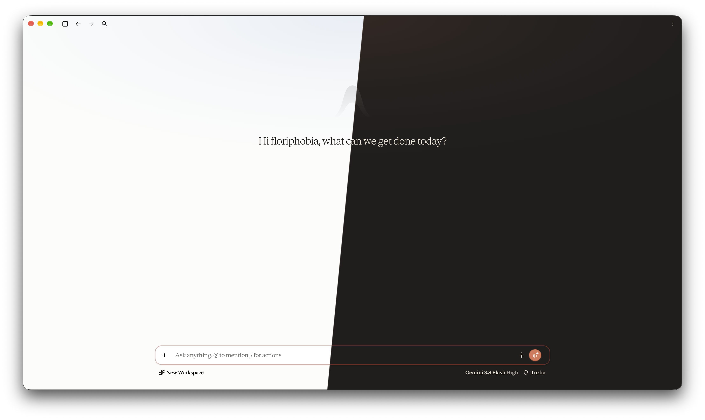
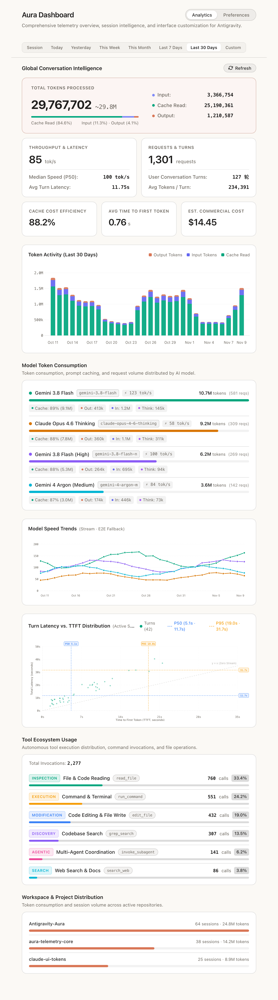
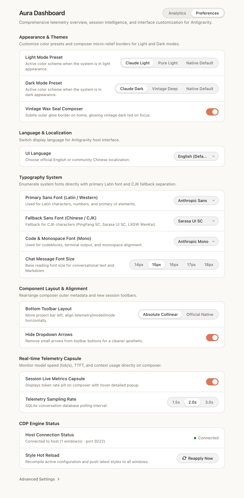

<div align="center">


# Antigravity Aura

**Anthropic 风格的明暗主题、字体混排与本地性能监控插件，基于 Google Antigravity 原生 Plugin + Sidecar 机制实现。**

[](https://github.com/sayakaho/Antigravity-Aura/releases)
[](https://github.com/sayakaho/Antigravity-Aura/actions/workflows/release.yml)
[](https://nodejs.org/)
[](https://github.com/sayakaho/Antigravity-Aura)
[](LICENSE)

[English](README.md) | 简体中文

[功能特性](#功能特性) · [界面预览](#界面预览) · [安装](#安装) · [配置](#配置) · [架构](#架构) · [致谢](#致谢)

</div>

## 简介

**Antigravity Aura** 运行于 Google Antigravity 的原生 Plugin + Sidecar 生命周期内，无需常驻系统守护进程或手动启动参数。Sidecar 随宿主启动后会自动检测 CDP 就绪状态（必要时自动备份 `app.asar.bak` 并幂等注入 `--remote-debugging-port=0` 实现零配置接入），通过 CDP 协议向活跃窗口热注入样式与脚本，并自适应使用原生 SQLite 驱动或内置 WASM 引擎解析本地对话库，在侧边栏提供实时性能统计与偏好设置面板。

## 界面预览

### 主工作台



### 侧边栏面板

<table>
  <tr>
    <th width="50%">Analytics 性能统计</th>
    <th width="50%">Preferences 偏好设置</th>
  </tr>
  <tr>
    <td valign="top" align="center">
      
    </td>
    <td valign="top" align="center">
      
    </td>
  </tr>
</table>

## 功能特性

- **实时遥测与本地性能看板**：基于本地对话记录提供从即时状态到历史复盘的全链路监控。
  - **输入框指标胶囊**：在输入框底部常驻展示最近一次响应的生成速率（`tok/s`）、TTFT、上下文占用与输出量；悬停可查看思考链与正文拆解、缓存命中率及距上下文压缩的剩余空间，点击即可切换侧边栏。
  - **多维度性能看板**：支持按当前会话或指定时间范围（今日、近 7/30 天、自定义日期等）聚合统计，覆盖 Token 构成与缓存效率、Gemini 模型 API 等价成本、各模型实测速率与延迟分布，以及工具调用和工作区占比。
  - **账号配额与一年期活跃度热力图**：直观展示多账号消耗占比与当前 Plan 订阅状态，配合一年期容量活跃度热力矩阵与 5h / 7d 配额预算反推，随时掌握账号额度演变。
  - **Google 原生账号切换与凭证保险库**：在侧边栏与控制面板内一键切换已认证的 Google 账号，显示真实头像、邮箱与订阅 Plan 标签，并自动同步 Keychain 与本地安全保险库凭据。
- **Claude 风格主题与字体混排**：统一明暗视觉观感，解决原版界面中英混排的割裂问题。
  - **双模式独立预设**：为亮色（`Claude Light`、`Pure Light`、`Native Default`）与暗色（`Claude Dark`、`Vintage Deep`、`Native Default`）分别指定独立方案，随系统外观自动切换。
  - **三轨字体独立配置**：自动识别本机已安装字体，支持西文主字体、CJK 中文回退、等宽代码字体与对话阅读字号分别设置。
- **多语言本地化、细节打磨与跨窗口热重载**：支持英文、简体中文（`zh-CN`）、日语（`ja-JP`）与韩语（`ko-KR`）在宿主界面与 Aura 侧边栏面板间无损切换，并支持自定义词典覆盖；提供输入框工具栏水平对齐与可选暗红蜡封聚焦边框，所有面板设置与 `custom.css` / `custom.js` 扩展均跨窗口即时生效、无需重启。
- **零配置自愈、防篡改守卫与开发者特性注入**：启动时自动保障宿主 CDP 注入就绪（自动保留 `.bak` 备份），修复设置弹窗偶发无法打开的问题并恢复窗口缩放快捷键；通过深度代理与存储防篡改守卫确保 Antigravity 原生 Developer 开发者模式稳定解锁，并提供清晰的客户端功能与服务端依赖边界指引。

## 环境要求

| 依赖 | 要求 | 适用阶段 |
| :--- | :--- | :--- |
| **Google Antigravity** | 支持 Plugin + Sidecar（若未开启 CDP，首次启动将自动安全自愈） | 运行时 |
| **Node.js** | `>= 18.0.0`（Node 22+ 原生加速，低版本自动 WASM 兜底）或 **Bun** | 运行时 |
| **Bun** | `>= 1.2` | 源码构建与测试 |
| **系统** | macOS / Windows / Linux | 运行与构建 |

## 安装

### 使用 Antigravity 安装

将本仓库链接直接复制发送给 **Antigravity**，让它为你完成安装并启用插件：

```text
请帮我安装这个 Antigravity 插件：https://github.com/sayakaho/Antigravity-Aura
```

安装完成后重启 Antigravity 即可加载插件。

### 下载构建产物

1. 去 [GitHub Releases](https://github.com/sayakaho/Antigravity-Aura/releases) 下载最新的 `aura-dashboard-v*.zip`。
2. 解压至插件目录，确保 `plugin.json` 位于该目录根部：
   ```text
   ~/.gemini/config/plugins/aura-dashboard
   ```
3. 重启 Antigravity，点击输入框左侧指标胶囊或通过右上角 **⋮ → Extensions → Aura Dashboard** 打开面板。

### 源码构建

```bash
git clone https://github.com/sayakaho/Antigravity-Aura.git
cd Antigravity-Aura

bun install
bun run typecheck
bun test
bun run build
bun run link:plugin
```

可通过 Antigravity CLI 校验并管理插件状态：

```bash
agy plugin validate ./dist
agy plugin enable aura-dashboard
agy plugin disable aura-dashboard
```

## 配置

常规主题、字体与采样参数可直接在侧边栏 **Preferences** 中实时修改。

首次启动时，宿主会在 `~/.gemini/antigravity/plugin_data/aura-dashboard/` 下初始化持久化配置目录。后续更新插件不会覆盖该目录中的文件：

| 文件 | 说明 |
| :--- | :--- |
| `config.json` | 插件主配置文件 |
| `custom.css` | 启用 `modules.customCss` 后追加加载的自定义样式表 |
| `custom.js` | 启用 `modules.customJs` 后在顶层窗口执行的扩展脚本 |
| `i18n.override.json` | 覆盖当前激活语言词典的自定义词条 |
| `account_timeline.json` / `quota_calibration.json` | 运行时自动维护的账号时间线与配额差分校准持久化文件 |

## 架构

```text
Antigravity Host
   │
   ├──► Sidecar Server — dist/sidecars/dashboard/main.mjs
   │       ├── 零配置宿主 app.asar 自愈（自动保留 .bak 备份）
   │       ├── SQLite/Protobuf 对话解析与 Language Server 配额/账号遥测
   │       ├── 配置校验与注入脚本编译
   │       ├── CDP 窗口发现与 CSS/JS 热推送
   │       └── 本地 HTTP 服务与侧边栏 Webview 接口
   │
   └──► Host Window — Injected Runtime
           ├── 模块化主题样式表、字体栈与输入框布局样式
           ├── WeakMap 多语言本地化（zh-CN / ja-JP / ko-KR）与宿主修复
           └── 实时指标胶囊、Google 原生账号切换与实验特性同步
```

<details>
<summary>目录结构</summary>

```text
Antigravity-Aura/
├── .github/workflows/release.yml   # CI 校验与构建发布流程
├── assets/                         # 插件图标与预览截图
├── scripts/                        # 构建与插件软链脚本
├── skills/aura-theme/SKILL.md      # 内置技能声明、配置 Schema 与 HTTP 接口规范
├── src/
│   ├── injection/                  # 窗口注入运行时、模块化 styles/、locales/ 与修复模块
│   ├── panel/                      # 侧边栏 Webview 前端与面板多语言引擎
│   ├── presets/                    # 用户配置目录初始模板
│   ├── server/                     # Sidecar 后端、宿主自愈、数据解析与 CDP 客户端
│   ├── shared/                     # 共享定价注册表、TPS 速率计算与配置校验
│   └── types/                      # TypeScript 类型与 SDK 声明
├── tests/                          # 单元测试
├── LICENSE
├── package.json
├── plugin.json                     # 插件清单
└── tsconfig.json
```

</details>

配置结构、扩展脚本契约与 HTTP 接口细节参见 [`skills/aura-theme/SKILL.md`](skills/aura-theme/SKILL.md)。

## 致谢

本项目参考了 **船板（[@Anarcadia](https://github.com/Anarcadia)）** 的 [**chuanban-antigravity-theme-patch**](https://github.com/Anarcadia/chuanban-antigravity-theme-patch)，主要借鉴了以下部分：

- 暖纸色亮色配色方案与字体混排思路
- 初版简体中文界面翻译词典
- 输入框实时指标胶囊构想

本项目遵循 [MIT](LICENSE) 协议开源。
