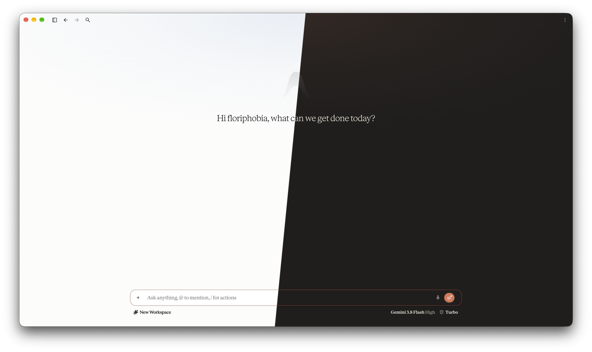
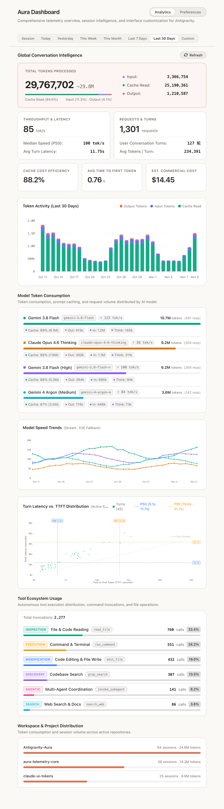
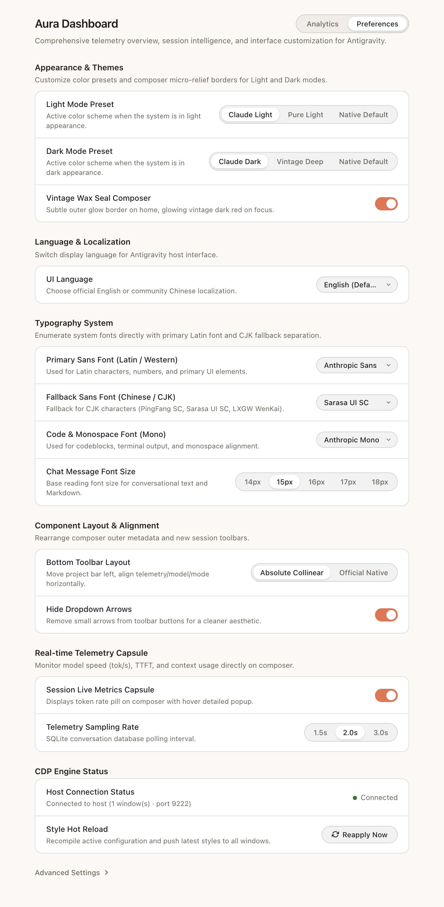

<div align="center">


# Antigravity Aura

**面向 Google Antigravity 的原生 Plugin + Sidecar 套件：集类 Claude 亮/暗主题预设、多链字体排版、中英切换与基于 SQLite 的全栈实时性能遥测看板于一体。**

[](https://github.com/sayakaho/Antigravity-Aura/releases)
[](https://github.com/sayakaho/Antigravity-Aura/actions/workflows/release.yml)
[-339933.svg)](https://nodejs.org/)
[](https://github.com/sayakaho/Antigravity-Aura)
[](package.json)

[English](README.md) | 简体中文

[核心特性](#核心特性) · [界面预览](#界面预览) · [安装指南](#安装指南) · [配置与定制](#配置与定制) · [架构设计](#架构设计) · [本地开发](#本地开发) · [致谢与声明](#致谢与声明)

</div>

---

## 项目简介

**Antigravity Aura**（插件标识 `aura-dashboard`）完全运行于 Google Antigravity 原生 **Plugin + Sidecar** 托管生命周期之内。无需篡改客户端 `.asar` 本体，也无需部署操作系统级常驻后台脚本；Sidecar 进程随宿主启停自动调度，通过 Chrome DevTools Protocol（CDP）发现并注入活跃窗口，借助 Node 22 原生 `node:sqlite` 增量解析本地对话数据库，并在宿主 Auxiliary Pane 侧边栏提供多维性能分析与实时控制台。

---

## 界面预览

> [!NOTE]
> 以下为 `v0.1.0` 正式版界面展示占位区。将实机截图保存至对应路径后，取消注释下方的图片标签即可展示。

### 工作台与实时遥测胶囊

> **展示图占位** — 请将截图保存至 `assets/screenshot-workspace.png`  
> 建议展示：主工作区亮/暗色主题效果、输入框底部组件水平共线布局，以及实时遥测胶囊（`tok/s · TTFT · Ctx · Out`）及其悬停详情浮层。

<!--  -->

### 侧边栏控制台（Analytics & Preferences）

| Analytics 性能分析视图（`assets/screenshot-analytics.png`） | Preferences 实时控制台视图（`assets/screenshot-preferences.png`） |
| :--- | :--- |
| **展示图占位** — 6 项 KPI 核心卡片、Token Activity（`Overview` / `Timeline`）、`Model Speed Trends` 与 `Turn Latency vs. TTFT` 散点分布图。 | **展示图占位** — 亮/暗预设切换、系统字体枚举与三链配置、遥测采样率、CDP 挂载状态与瞬时热重载控制。 |
| <!--  --> | <!--  --> |

---

## 核心特性

- **类 Claude 亮/暗配色预设**：独立配置 Light（`Claude Light` / `Pure Light` / `Native Default`）与 Dark（`Claude Dark` / `Vintage Deep` / `Native Default`）视觉主题。
- **三链字体排版系统**：通过宿主接口与 `fc-list` 自动枚举本机已安装字体，独立配置西文主字体、CJK 回退字体、等宽代码字体与对话阅读字号（`10–28px`）。
- **输入框与界面交互优化**：
  - 底部工具栏水平共线布局（遥测胶囊、模型选择器与模式选择器对齐，支持隐藏下拉小箭头）。
  - 支持「古朴暗红蜡封」输入框聚焦边框，以及新建对话界面多组件 Hover 透明背景与边框阴影修复。
  - 中英界面切换（`English (Default)` / `Chinese (Simplified)`），基于 `WeakMap` 保留原文支持无损热切换，支持用户自定义词典覆盖。
- **桌面实时遥测胶囊**：嵌入输入框左侧，定时读取本地 SQLite/Protobuf 对话库并展示 `tok/s · TTFT · Ctx% · Out`；点击胶囊即可快速打开或折叠侧边栏控制台。
- **多维性能分析看板（Analytics）**：
  - 支持 8 档时间维度联动（`Session`、`Today`、`Yesterday`、`This Week`、`This Month`、`Last 7 Days`、`Last 30 Days`、`Custom` 自定义区间）。
  - 抽离公共 [`src/shared/tps.ts`](src/shared/tps.ts)，确保实时胶囊、会话明细、模型速度曲线与全局日/小时汇总严格采用统一的加权 TPS 口径。
  - 提供 6 项核心 KPI 指标（Token 消耗与占比、加权/P50 速率与平均轮次延迟、请求与轮次数、缓存命中率、平均 TTFT、分模型精算成本）、会话 `Overview / Timeline` 图表、`Turn Latency vs. TTFT` 散点分布图（含 `P50 / P95` 参考线），以及模型/工具/Workspace 项目分布统计。
- **宿主防护与样式热重载**：内置设置路由死锁与缩放快捷键修复、`StorageEvent` 同窗同步的安全实验 Flag 开关（双层拦截高风险崩溃项），并支持一键 `Reapply Now` 跨窗口瞬时热重载。

---

## 运行与构建环境

| 依赖项 | 版本 / 说明 | 适用范围 |
| :--- | :--- | :--- |
| **Google Antigravity** | 需支持原生 Plugin + Sidecar 机制与 CDP 调试端口 | 运行期 |
| **Node.js** | `>= 22.13.0`（依赖原生内置 `node:sqlite`） | 运行期 |
| **Bun** | `>= 1.2` | 仅源码构建与单测 |
| **操作系统** | macOS、Windows 或 Linux | 运行与构建 |

---

## 安装指南

### 方式一：下载 Release 产物安装（推荐用户）

1. 前往 [GitHub Releases](https://github.com/sayakaho/Antigravity-Aura/releases) 下载最新的 `aura-dashboard-v*.zip`（可选配合 `.sha256` 校验文件完整性）。
2. 将压缩包内容直接解压至：
   ```text
   ~/.gemini/config/plugins/aura-dashboard
   ```
   *（确保 `plugin.json` 位于该目录第一层根路径下。）*
3. 重启 Antigravity，点击输入框遥测胶囊或从会话右上角 **⋮ → Extensions → Aura Dashboard** 打开面板。

### 方式二：源码构建与软链接（开发者）

```bash
git clone https://github.com/sayakaho/Antigravity-Aura.git
cd Antigravity-Aura

bun install
bun run typecheck      # 严格 TypeScript 类型检查
bun test               # 运行单元测试套件
bun run build          # 编译单文件 Sidecar 并打包至 dist/
bun run link:plugin    # 将 dist/ 软链接至 ~/.gemini/config/plugins/aura-dashboard
```

使用 Antigravity CLI 校验产物与管理启停状态：

```bash
agy plugin validate ./dist
agy plugin enable aura-dashboard
agy plugin disable aura-dashboard
```

---

## 配置与定制

所有主题预设、字体排版、遥测采样率、布局及实验特性均可在侧边栏 **Preferences** 视图实时调整并立即生效。

如需文件级深度改装，Antigravity 首次启动插件时会自动从 [`src/presets/`](src/presets) 初始化持久化目录 `~/.gemini/antigravity/plugin_data/aura-dashboard/`；后续升级插件绝不覆盖该目录中的已有个人文件：

| 文件 | 作用说明 |
| :--- | :--- |
| `config.json` | 经 Schema 强校验的插件主配置（`presets`、`typography`、`composer`、`telemetry`、`language`、`advanced`）。 |
| `custom.css` | 开启 `modules.customCss` 时追加注入至内置主题样式之后的个人 CSS。 |
| `custom.js` | 开启 `modules.customJs` 时在宿主顶层窗口执行的前端扩展脚本（注入 `ctx` 运行时上下文）。 |
| `i18n.override.json` | 在内置简体中文词典（`zh-CN`）之上叠加或覆写的自定义词条 JSON。 |

> **可选字体搭配建议**：推荐搭配 `Anthropic Sans`、`Anthropic Serif`、`Anthropic Mono`、`Sarasa Gothic`（更纱黑体）或 `LXGW WenKai`（霞鹜文楷）；也可在 Preferences 中直接下拉选择本机已安装的任意字体。

---

## 架构设计

```text
Antigravity 宿主（Electron + CDP + 本地 SQLite/Protobuf 数据库）
   │
   ├──► Sidecar 后台引擎（dist/sidecars/dashboard/main.mjs）
   │       ├── SQLite + BigInt Protobuf 解码器与全局统计缓存
   │       ├── 配置规范化与注入脚本动态合成器
   │       ├── CDP 连接管理器（自动发现端口并推流 CSS/JS 热更新）
   │       └── Sidecar HTTP 服务与 Auxiliary Pane Webview API
   │
   └──► 宿主顶层窗口（注入运行时）
           ├── 亮/暗预设样式、排版变量与蜡封/共线输入框布局
           ├── WeakMap 无损本地化引擎与路由死锁/缩放快捷键修复
           └── 实时遥测胶囊 + StorageEvent 安全实验特性同步
```

<details>
<summary>仓库目录结构</summary>

```text
Antigravity-Aura/
├── .github/workflows/release.yml   # GitHub Actions CI 验证、打包 Release Zip 与校验和工作流
├── assets/                         # 插件矢量图标 (logo.svg) 与文档展示图片资源
├── scripts/                        # Bun 单包内联构建与插件链接脚本 (build.ts, link.ts, unlink.ts)
├── skills/aura-theme/SKILL.md      # 随插件分发包一同安装的运行期 Agent 技能
├── src/
│   ├── injection/                  # 宿主窗口注入运行时、theme.css、i18n、修复器与实验特性同步
│   ├── panel/                      # Auxiliary Pane 侧边栏前端（analytics/*、settings、theme-sync）
│   ├── presets/                    # 用户改装层模板（打包至 dist/sidecars/dashboard/user/）
│   ├── server/                     # Sidecar Node ESM 后端（SQLite/Protobuf、CDP 与 HTTP 服务）
│   ├── shared/                     # 前后端共享纯逻辑（tps、config-schema、catalog、format）
│   └── types/                      # 全局 TypeScript 类型契约与 Sidecar SDK 声明
├── tests/                          # Bun 单元测试套件
├── package.json
├── plugin.json                     # Antigravity 官方 /plugin 清单
├── SKILL.md                        # 开发者与 AI Agent 技术契约文档
└── tsconfig.json
```

</details>

更完整的源码契约、内联构建边界、数据 Schema 与 Sidecar HTTP API 说明，请参阅 [`SKILL.md`](SKILL.md)。

---

## 本地开发

```bash
bun run dev            # 监听 src/ 目录变动增量重建 dist/
bun run typecheck      # 运行 TypeScript 严格类型检查
bun test               # 运行全部单元测试
bun run build          # 生成精简生产构建包 dist/（11 个核心文件，约 308 KB）
bun run unlink:plugin  # 移除 ~/.gemini/config/plugins/aura-dashboard 软链接
```

推送 `v*` 标签或在 GitHub Actions 页面手动触发 [`.github/workflows/release.yml`](.github/workflows/release.yml) 时，工作流将自动执行锁定依赖安装、类型检查、单元测试、Node 22 `node:sqlite` 与语法校验、`/plugin` 清单检查，并输出附带 `.sha256` 的分发压缩包。

---

## 致谢与声明

**Antigravity Aura** 最初基于 **船板（[@Anarcadia](https://github.com/Anarcadia)）** 的开源项目 [**Anarcadia/chuanban-antigravity-theme-patch**](https://github.com/Anarcadia/chuanban-antigravity-theme-patch) 衍生并独立演进，特此向原作者致谢：

- **继承自原项目的设计与基石**：Anthropic 暖纸高对比亮色配色审美、`Anthropic` / `Sarasa` 多链字体排版方案、基础中文界面词典、输入框实时指标胶囊构想，以及设置路由死锁修复思路。
- **独立项目阶段的演进**：脱离外部系统级常驻守护脚本并迁移至 Antigravity 原生 `Plugin + Sidecar` 机制；全栈重构为 Strict TypeScript 与 Bun 单文件内联产线；新增 Auxiliary Pane 双视图（Analytics 性能分析看板与 Preferences 实时控制台）、深色预设（`claude-dark` / `vintage-dark`）、中英开关、统一 TPS 计算引擎、新建对话工具栏 Hover 修复、`StorageEvent` 实验特性同步、单元测试套件与自动化 CI/Release 发布流程。
- **提交历史与许可**：仓库保留完整的 Git 提交历史以留存原始贡献脉络；本项目工程元数据与新增实现按 [`MIT`](package.json) 协议声明（注：上游原仓库未附带 `LICENSE` 文件）。
